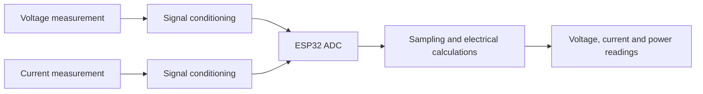

# Energy Meter

**AC voltage, current and power measurement with an ESP32.**

This repository summarises the energy-measurement work from my 2020 final degree project in Electrical and Computer Engineering at Instituto Superior de Engenharia do Porto (ISEP).

I developed voltage and current measurement circuits, conditioned the signals for the ESP32 ADC and implemented the electrical calculations. The prototype readings were compared with external instruments during bench checks.

**Author:** Filipe Fonseca · **Year:** 2020 · **Status:** Academic prototype

## Measurement work

- Voltage measurement with electrical isolation and signal conditioning.
- Current measurement and adjustment of the sensor output for the ADC.
- Sampling and calculation of RMS voltage, RMS current and active power.
- Calculation of apparent power and power factor.
- Comparison of prototype readings with reference instruments.

## Measurement chain

The diagram shows the measurement stages at a general level.

[Read the measurement notes](docs/MEASUREMENT.md).

## Recorded results

The original report records differences of approximately **0.2% for voltage**, **0.7% for current** and **3% for active power** at individual bench comparison points.

These are historical comparisons from the prototype, not an accuracy rating across its operating range. The reference used for current and power had no accredited calibration.

[Read the comparisons and their limits](docs/RESULTS.md).

## EV charging control

The original project also included charging current control for an electric vehicle charger. The ESP32 generated a PWM signal for the control pilot circuit and read the vehicle connection state. A mobile app allowed the user to request the charging current.

This repository focuses on the energy meter. The charging control work is included here as context for the original application.

## Technologies used

The following technologies were used across the original project:

| Technology | Role |
| --- | --- |
| Analogue electronics | Voltage and current sensing, isolation, filtering and signal conditioning |
| ESP32 | Signal acquisition, electrical calculations and charging control |
| C / ESP-IDF | Embedded firmware |
| Wi-Fi / MQTT | Communication between the meter, server and app |
| Raspberry Pi / Mosquitto | Message broker and server hosting |
| Python / SQLite | Measurement storage and consumption history processing |
| Flutter / Dart | Mobile interface for readings, history and charging requests |

## Project context

This work formed part of an academic project based on a topic proposed by a company. I developed the project and have chosen to keep the original source code private.

## Scope

This repository contains a technical summary of the measurement work. It covers the analogue signal path, embedded processing and recorded bench comparisons.

The prototype was an academic exercise and was not a certified measurement or billing instrument. The measurement approach could be developed further for other energy-monitoring applications.
